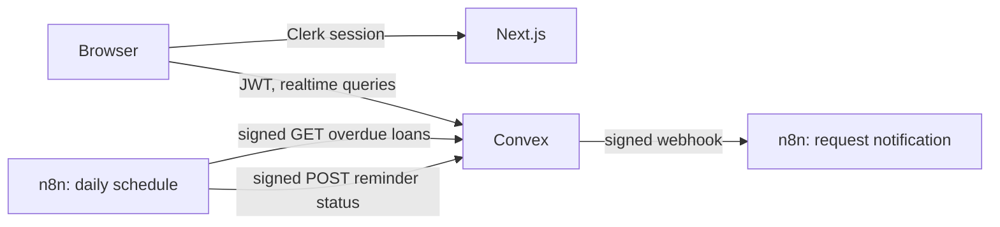

# LendLoop

A neighborhood tool-lending board: neighbors list tools, request to borrow from each other, and get automated notifications and reminders through n8n.

**Stack:** Next.js (App Router), Clerk, Convex, n8n, TypeScript.

> **Status: in progress.** The public page, sign-in, listings, and borrowing work. Admin views, HTTP endpoints, and n8n workflows are still to come. Items marked _planned_ describe the intended design, not working code.

## Local setup

Prerequisites: Node 20+, Docker, a [Clerk](https://clerk.com) application, and a [Convex](https://convex.dev) account.

```bash
npm install
cp .env.example .env.local
```

Add your Clerk keys to `.env.local`.

**Clerk:** in the dashboard, activate the Convex integration and copy the Frontend API URL. Under **Sessions**, customize the session token so Convex receives the user's profile:

```json
{
  "email": "{{user.primary_email_address}}",
  "name": "{{user.full_name}}"
}
```

**Convex:** start `npx convex dev` and leave it running. Its first push fails until the issuer is set, so run this in a second terminal:

```bash
npx convex env set CLERK_JWT_ISSUER_DOMAIN https://your-instance.clerk.accounts.dev
```

**Next.js:**

```bash
npm run dev
```

The app runs at http://localhost:3000.

**n8n:**

```bash
cp n8n/.env.example n8n/.env
```

Set `N8N_ENCRYPTION_KEY` in `n8n/.env`, then start n8n:

```bash
docker compose up -d
```

The editor runs at http://localhost:5678.

A cloud Convex deployment cannot reach `localhost`, so expose n8n through a tunnel (for example `cloudflared tunnel --url http://localhost:5678`) and set `WEBHOOK_URL` and `N8N_WEBHOOK_URL` to that URL.

**Make yourself an admin** after signing in once:

```bash
npx convex run users:setRole '{"email":"you@example.com","role":"admin"}'
```

## Environment variables

| Variable | Where it is set | Purpose |
| --- | --- | --- |
| `NEXT_PUBLIC_CONVEX_URL` | `.env.local` | Convex client URL |
| `NEXT_PUBLIC_CLERK_PUBLISHABLE_KEY` | `.env.local` | Clerk client key |
| `CLERK_SECRET_KEY` | `.env.local` | Clerk server key |
| `CLERK_JWT_ISSUER_DOMAIN` | Convex | Validates Clerk JWTs |
| `N8N_WEBHOOK_URL` | Convex | Request notification webhook (_planned_) |
| `N8N_WEBHOOK_SECRET` | Convex, n8n credential | Signs Convex to n8n calls (_planned_) |
| `CONVEX_INBOUND_SECRET` | Convex, n8n credential | Signs n8n to Convex calls (_planned_) |
| `N8N_ENCRYPTION_KEY` | `n8n/.env` | Encrypts n8n credentials at rest |
| `WEBHOOK_URL` | `n8n/.env` | Public URL n8n advertises |

## Architecture



```text
convex/             Backend: schema, queries, mutations, HTTP endpoints
  lib/auth.ts       requireUser / requireAdmin, the authorization entry points
  lib/constants.ts  Shared validators
  http.ts           Endpoints called by n8n
src/app/            Public page and the signed-in (app) route group
src/components/     Shared UI
src/proxy.ts        Clerk session handling
n8n/workflows/      Exported workflow JSON (no secrets)
docker-compose.yml  Local n8n
```

**Data model.** An approved `borrowRequests` row is the loan, so there is one status machine and no request and loan tables to keep in sync: `pending -> approved -> returned`, or `pending -> declined | cancelled`. Dates are `YYYY-MM-DD` strings, which sort correctly and avoid timezone drift.

**Borrowing rules.**

- A tool has one active loan at a time and counts as on loan from approval until it is returned, which keeps availability a simple status rather than a date calculation.
- Approving a request declines pending requests with overlapping dates. Non-overlapping requests stay pending and can be approved after the return.
- Only the lender can mark a loan returned, so a borrower cannot clear an overdue loan without giving the tool back.
- Requests keep a copy of the tool's name, so history survives the listing being deleted. Deleting a listing cancels its pending requests and is blocked while the tool is on loan.
- Every status change goes through `setRequestStatus` in `convex/lib/borrowRequests.ts`, which enforces the allowed transitions.

## Security and data minimization

- **Authorization lives in Convex.** The sign-in redirect in the `(app)` layout only improves UX; every function derives the caller from the verified JWT and never accepts a user ID or role as an argument.
- **Roles live in Convex.** New users are always `user`. `users:setRole` is an internal function, so no client can call it.
- **Contact details are shared only when needed.** Each party sees the other's email only while a loan is active, to arrange the handover.
- **The public query returns an explicit projection** of name and category, so owner details cannot leak when the schema grows.
- **n8n's editor binds to loopback** and its image version is pinned.
- _Planned:_ HMAC-signed payloads with timestamps in both directions, minimal webhook fields, idempotency keys on write-backs, retries, and an error workflow.

## Running in production

_To be completed with the implementation._
