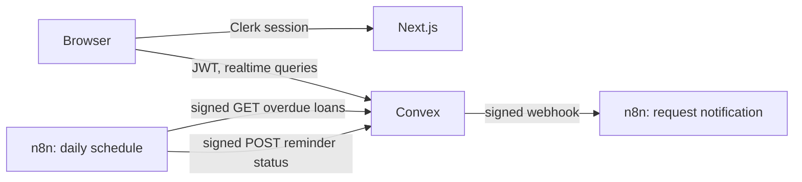

# LendLoop

A neighborhood tool-lending board: neighbors list tools, request to borrow from each other, and get automated notifications and reminders through n8n.

**Stack:** Next.js (App Router), Clerk, Convex, n8n, TypeScript.

**Docs:** [User guide](doc/user-guide.md) · [Architecture](doc/architecture.md)

## Local setup

Prerequisites: Node 20+, Docker, a [Clerk](https://clerk.com) application, and a [Convex](https://convex.dev) account.

```bash
npm install
cp .env.example .env.local
```

Add your Clerk keys to `.env.local`.

**Clerk:** in the dashboard, activate the Convex integration and copy the Frontend API URL. Under **Sessions**, customize the session token so Convex receives the user's profile:

```json
{
  "email": "{{user.primary_email_address}}",
  "name": "{{user.full_name}}"
}
```

**Convex:** start `npx convex dev` and leave it running. Its first push fails until the issuer is set, so run this in a second terminal:

```bash
npx convex env set CLERK_JWT_ISSUER_DOMAIN https://your-instance.clerk.accounts.dev
```

**Next.js:**

```bash
npm run dev
```

The app runs at http://localhost:3000.

**n8n:** create the env file, then generate its three secrets with `openssl rand -hex 32`:

```bash
cp n8n/.env.example n8n/.env
```

Fill in `n8n/.env`, using `NEXT_PUBLIC_CONVEX_SITE_URL` from `.env.local` as `CONVEX_SITE_URL`. Give Convex the same two signing secrets:

```bash
npx convex env set N8N_WEBHOOK_SECRET your-webhook-secret
npx convex env set CONVEX_INBOUND_SECRET your-inbound-secret
```

Start n8n and import the workflows:

```bash
npm run n8n:up
npm run n8n:setup
```

The editor runs at http://localhost:5678.

A cloud Convex deployment can't reach `localhost`, so start the tunnel and point Convex at it. The public URL only reaches n8n's production webhooks, because it goes through a proxy that blocks the editor and API.

```bash
npm run n8n:tunnel
npm run n8n:tunnel-url
npx convex env set N8N_WEBHOOK_URL https://your-url.trycloudflare.com/webhook/lendloop-request-event
```

The tunnel URL changes each time the tunnel restarts, so repeat the last two commands when it does.

**Make yourself an admin** after signing in once:

```bash
npx convex run users:setRole '{"email":"you@example.com","role":"admin"}'
```

## Environment variables

| Variable                            | Where it is set    | Purpose                               |
| ----------------------------------- | ------------------ | ------------------------------------- |
| `NEXT_PUBLIC_CONVEX_URL`            | `.env.local`       | Convex client URL                     |
| `NEXT_PUBLIC_CLERK_PUBLISHABLE_KEY` | `.env.local`       | Clerk client key                      |
| `CLERK_SECRET_KEY`                  | `.env.local`       | Clerk server key                      |
| `CLERK_JWT_ISSUER_DOMAIN`           | Convex             | Validates Clerk JWTs                  |
| `N8N_WEBHOOK_URL`                   | Convex             | Request notification webhook          |
| `N8N_WEBHOOK_SECRET`                | Convex, `n8n/.env` | Signs Convex to n8n calls             |
| `CONVEX_INBOUND_SECRET`             | Convex, `n8n/.env` | Signs n8n to Convex calls             |
| `CONVEX_SITE_URL`                   | `n8n/.env`         | Where n8n calls Convex                |
| `N8N_ENCRYPTION_KEY`                | `n8n/.env`         | Encrypts n8n credentials at rest      |
| `WEBHOOK_URL`                       | `n8n/.env`         | Public URL n8n advertises             |
| `E2E_USER_EMAIL`                    | `.env.local`       | Optional user for signed-in e2e tests |

## Development

| Command                 | What it does                                |
| ----------------------- | ------------------------------------------- |
| `npm run check`         | Checks formatting and lint, then typechecks |
| `npm run format`        | Formats everything with Prettier            |
| `npm run lint:fix`      | Fixes what ESLint can                       |
| `npm test`              | Runs the unit tests once                    |
| `npm run test:watch`    | Runs the unit tests on each change          |
| `npm run test:coverage` | Runs the unit tests and reports coverage    |
| `npm run test:e2e`      | Runs the Playwright tests                   |

Unit tests use Vitest and `convex-test`, which runs Convex functions against an in-memory backend. They live next to the code as `*.test.ts`, and Convex doesn't deploy them. Coverage measures `convex/` and `src/lib/`, and CI fails if it drops below 90% of statements, functions and lines or 85% of branches. React components are exercised by the Playwright tests instead.

Playwright tests live in `e2e/`. Install the browser once with `npx playwright install chromium`. The signed-in test creates and deletes a tool on your dev deployment, using the Clerk user in `E2E_USER_EMAIL`, and is skipped if that isn't set.

### CI

GitHub Actions runs on every push: format, lint and typecheck; unit tests with coverage, shown on the run's summary page; and the Playwright tests against a production build.

The Playwright job needs a Clerk app and a Convex deployment, so it needs these repository secrets. Without them it passes with a warning and tests nothing. `E2E_USER_EMAIL` is optional, as it is locally.

```bash
gh secret set NEXT_PUBLIC_CONVEX_URL
gh secret set NEXT_PUBLIC_CLERK_PUBLISHABLE_KEY
gh secret set CLERK_SECRET_KEY
gh secret set E2E_USER_EMAIL
```

Each command prompts for its value. CI doesn't deploy Convex, so the tests run against whatever that deployment is running.

## Architecture



```text
convex/             Backend: schema, queries, mutations, HTTP endpoints
  lib/auth.ts       requireUser / requireAdmin, the authorization entry points
  lib/constants.ts  Shared validators
  lib/signature.ts  HMAC signing and verification
  notifications.ts  Signed webhook delivery with retries
  reminders.ts      Overdue loans and idempotent write-backs
  http.ts           Endpoints called by n8n
src/app/            Public page and the signed-in (app) route group
src/features/       Components that read or write Convex data, by domain
src/components/     Presentational components
src/proxy.ts        Clerk session handling
n8n/workflows/      Exported workflow JSON (no secrets)
e2e/                Playwright tests
docker-compose.yml  Local n8n, plus the optional proxy and tunnel
```

**Data model.** An approved `borrowRequests` row is the loan, so there is one status machine and no request and loan tables to keep in sync: `pending -> approved -> returned`, or `pending -> declined | cancelled`. Removing a listing as an admin also takes `approved -> cancelled`. Dates are `YYYY-MM-DD` strings, which sort correctly and avoid timezone drift.

**Borrowing rules.**

- A tool has one active loan at a time and counts as on loan from approval until it is returned, which keeps availability a simple status rather than a date calculation.
- Approving a request declines pending requests with overlapping dates. Non-overlapping requests stay pending and can be approved after the return.
- Only the lender can mark a loan returned, so a borrower cannot clear an overdue loan without giving the tool back.
- Requests keep a copy of the tool's name, so history survives the listing being deleted. Deleting a listing cancels its pending requests. Owners can't delete a tool that is on loan. Admins can, which closes the loan as `cancelled`, not `returned`, because nobody confirmed the tool came back, and which keeps a missing lender from leaving a listing stuck.
- Every status change goes through `setRequestStatus` in `convex/lib/borrowRequests.ts`, which enforces the allowed transitions.

## Security and data minimization

- **Authorization lives in Convex.** The sign-in redirect in the `(app)` layout only improves UX; every function derives the caller from the verified JWT and never accepts a user ID or role as an argument.
- **Roles live in Convex.** New users are always `user`. `users:setRole` is an internal function, so no client can call it.
- **Contact details are shared only when needed.** Each party sees the other's email only while a loan is active, to arrange the handover.
- **The public query returns an explicit projection** of name and category, so owner details cannot leak when the schema grows.
- **n8n's editor binds to loopback** and its image version is pinned.
- **Calls are signed in both directions** with HMAC-SHA256 over the timestamp and raw body. Calls to Convex also sign the method, path and query, so a captured signature can't be reused on another endpoint or with another cursor. Requests older than 5 minutes are rejected, and signatures are compared in constant time.
- **Secrets stay out of exported workflows.** They reference environment variables by name. The trade-off is that any workflow on the instance can read those values, so only trusted people should have n8n logins.
- **The tunnel only exposes webhooks,** through a proxy that returns 404 for n8n's editor and API.
- **Webhooks carry the minimum:** the recipient's name and email, the tool's name, and the dates. Logged notifications mask the email, and n8n deletes execution data after 7 days.

## Reliability

- **Notifications can't be lost by a crash mid-change.** The status change, its notification record, and its scheduled delivery commit in one transaction.
- **Delivery retries with backoff,** up to 5 attempts over about 40 minutes, then shows as failed under **Admin > Automation**. Delivery is at-least-once, so each webhook carries a stable `eventId` for a real provider to drop repeats.
- **Reminder write-backs are idempotent.** A loan and date map to one record, so retries return `duplicate`. Loans already reminded that day are left out of the next fetch.
- **Every overdue loan is reached.** The workflow follows the fetch's cursor through all pages, so a large backlog can't hide newer loans. A borrower with no email is reported as a failed reminder instead of being skipped.
- **Failed workflow runs are visible.** An error workflow logs them and reports them to Convex, which shows them under **Admin > Automation**.

## Running in production

This is built to run locally. I would change these before real users rely on it, most important first.

**Must have**

- **Send real email.** The workflows only log each notification, so nobody receives anything yet. I would add a provider such as Postmark or Resend to n8n, passing the `eventId` or reminder `idempotencyKey` that each workflow already receives so retries can't send a second email.
- **Host n8n properly.** The quick tunnel's URL changes on restart, and n8n's default SQLite database doesn't suit a production instance. I would use a fixed domain with TLS, Postgres, and a backed-up `N8N_ENCRYPTION_KEY`, and keep the editor behind a VPN or SSO.
- **Separate the environments.** Use production Clerk and Convex instances, with different secrets from development.
- **Tighten secret handling.** Workflows read secrets from environment variables, which any workflow can access. I would move them to a secrets manager or n8n credentials, then set `N8N_BLOCK_ENV_ACCESS_IN_NODE` to `true`. Rotating a signing secret today needs both sides changed at once, so verification should accept two secrets during the switch.
- **Add rate limits.** Input size is capped, but a signed-in user can still create unlimited listings and requests. I would limit both per user, and limit the signed n8n endpoints too.

**Should have**

- **Alert when automation stops.** Failures only appear under **Admin > Automation**, and if n8n is down, its error workflow can't report anything. I would page someone on repeated failures, and have Convex raise an alert if the daily overdue fetch doesn't arrive.
- **Delete personal data on schedule.** Nothing is removed yet. I would add a Convex cron that clears old automation records, and a Clerk `user.deleted` webhook that removes the user's profile and anonymizes their loans.
- **Use the borrower's timezone.** Reminders run at 09:00 UTC and use the UTC date, so a loan can count as overdue while it is still the due date for the borrower.
- **Make CI a gate.** CI reports results but doesn't block anything. I would require it to pass before merging and deploying, run the e2e tests against their own Convex deployment, deploy Convex from CI, and cover the full borrowing flow with two users.
