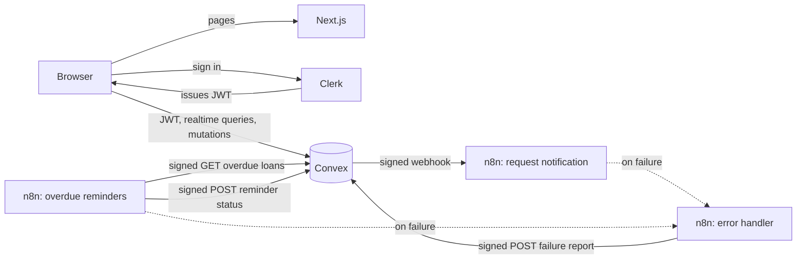
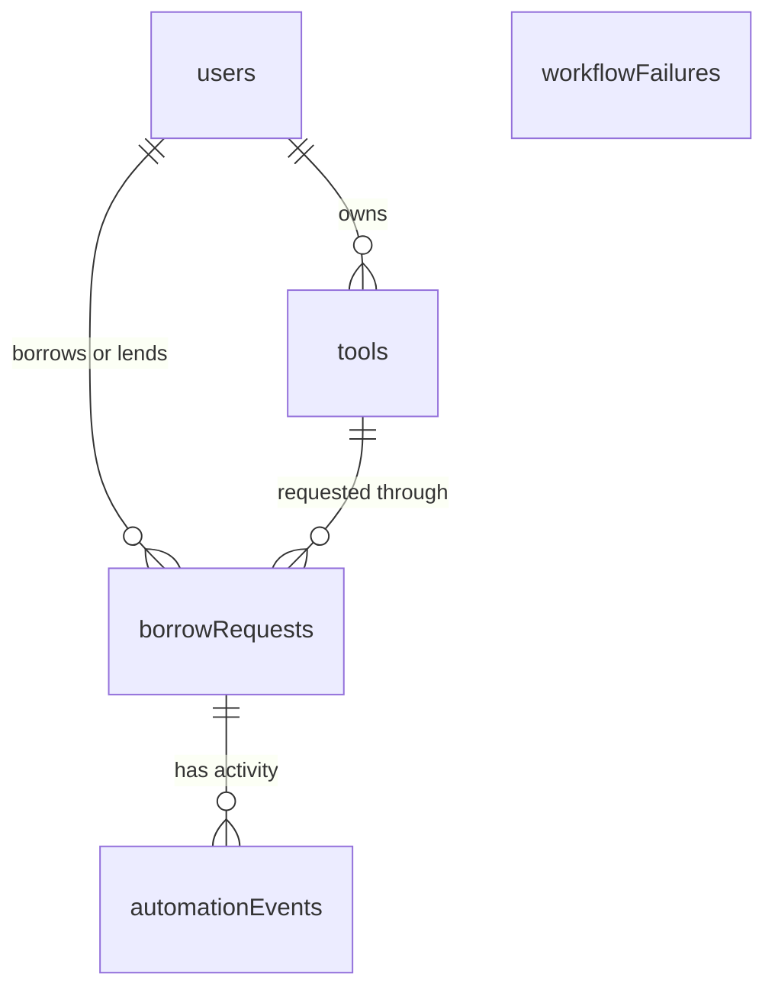
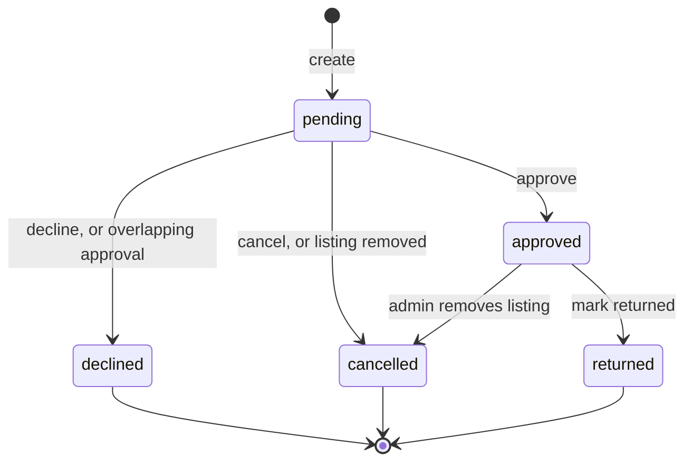
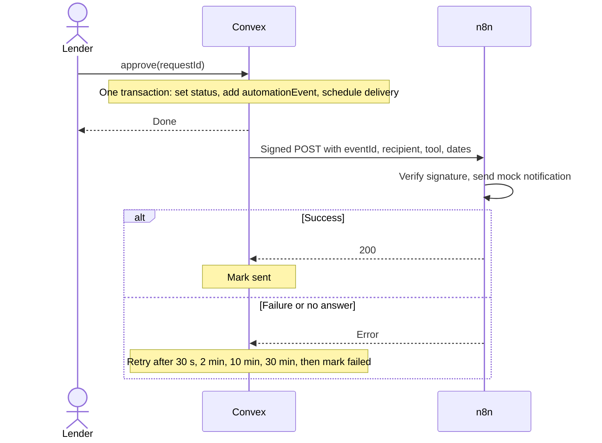

# LendLoop architecture

LendLoop is a Next.js client on top of a Convex backend. Convex holds all the data and every authorization rule, Clerk proves who the user is, and n8n runs the notification and reminder workflows. For what the app does, see the [user guide](user-guide.md). For setup, see the [README](../README.md).

## System overview



| Part    | Responsible for                                       | Deliberately not responsible for             |
| ------- | ----------------------------------------------------- | -------------------------------------------- |
| Next.js | Rendering, routing, and the sign-in redirect          | Data access and authorization                |
| Clerk   | Sign-in, sessions, and the JWT                        | Roles, which live in Convex                  |
| Convex  | Data, business rules, authorization, webhook delivery | Message content and sending                  |
| n8n     | Message content, sending, and the daily schedule      | Deciding who may do what, or keeping records |

The browser talks to Convex directly over a realtime connection, so Next.js has no API routes and pages update as soon as data changes.

## Code layout

```text
convex/                Backend
  schema.ts            Tables and indexes
  tools.ts             Listings
  requests.ts          Borrow requests and loans
  admin.ts             Admin-only queries and mutations
  users.ts             User sync and the internal setRole
  notifications.ts     Webhook delivery and retries
  reminders.ts         Overdue loans and idempotent write-backs
  http.ts              Signed endpoints called by n8n
  lib/auth.ts          requireUser, requireAdmin, and ownership checks
  lib/borrowRequests.ts  The request state machine
  lib/signature.ts     HMAC signing and verification
src/
  app/                 Routes: the public page and the signed-in (app) group
  features/            Components that read or write Convex data, by domain
  components/          Presentational components, which never call Convex hooks
  lib/                 Dates, errors, shared class names, useAsyncAction
  proxy.ts             Clerk session handling
n8n/workflows/         Exported workflow JSON, with no secrets
e2e/                   Playwright tests
```

Dependencies in the frontend point one way: `app` uses `features`, and `features` uses `components`. `AGENTS.md` lists the full conventions, and ESLint enforces the ones it can, such as alias-only imports and no type assertions.

## Authentication and authorization

1. Clerk signs the user in and issues a JWT, which `ConvexProviderWithClerk` attaches to Convex calls. `convex/auth.config.ts` tells Convex which issuer to trust.
2. `RequireUser` calls `users.store` after sign-in, which creates or refreshes the user's record from the verified token. New users are always `user`.
3. Every protected function starts from `requireUser` or `requireAdmin`, which look the caller up by the token's `tokenIdentifier`. No function accepts a user ID or role as proof of identity.

The `(app)` layout's redirect and the hidden admin link only improve the experience. Calling a function directly gets the same answer as using the UI:

| Action                          | Visitor | Borrower | Lender (own tool) | Admin          |
| ------------------------------- | ------- | -------- | ----------------- | -------------- |
| See available names, categories | Yes     | Yes      | Yes               | Yes            |
| Browse all tools                | No      | Yes      | Yes               | Yes            |
| Create a listing                | No      | Yes      | Yes               | Yes            |
| Edit a listing                  | No      | No       | Yes               | Own only       |
| Delete a listing                | No      | No       | Unless on loan    | Any            |
| Request a tool                  | No      | Yes      | Not their own     | Yes            |
| Cancel a pending request        | No      | Own only | No                | Own only       |
| Approve, decline, mark returned | No      | No       | Yes               | Own tools only |
| View all loans, automation      | No      | No       | No                | Yes            |
| Set Trusted Lender              | No      | No       | No                | Yes            |

`users.setRole` is an internal function, so it can only be run by someone with deployment access, through `npx convex run`.

## Data model



| Table              | Holds                                                                  |
| ------------------ | ---------------------------------------------------------------------- |
| `users`            | Name, email, role, and Trusted Lender flag, keyed by `tokenIdentifier` |
| `tools`            | Listing fields, owner, and `available` or `on_loan` status             |
| `borrowRequests`   | Tool, both parties, dates, and status. An approved request is the loan |
| `automationEvents` | Each notification and reminder, with status, attempts, and last error  |
| `workflowFailures` | Failed n8n runs, keyed by execution ID                                 |

### Request lifecycle



Every status change goes through `setRequestStatus` in `convex/lib/borrowRequests.ts`, which rejects any other transition and records the notification. `requests.cancel` is stricter and only accepts pending requests, so a borrower can't end their own active loan.

When an admin removes an on-loan listing, the loan closes as `cancelled` rather than `returned`, because nobody confirmed the tool came back. This keeps a missing lender from leaving a listing stuck, since only the lender can mark a loan returned.

Some decisions keep this model simple:

- **A loan is a request status, not a table.** There is one state machine, and no request and loan rows to keep in sync.
- **Availability is a status, not a date calculation.** A tool is on loan from approval until return, which rules out double-booking at the cost of not allowing back-to-back future loans.
- **Requests copy the tool's name,** so history survives the listing being deleted.
- **Dates are `YYYY-MM-DD` strings,** which sort correctly and carry no timezone. Server checks allow for a viewer's local date being a day behind UTC.

## Automation

### Request notification

Convex pushes each change to n8n, and the status change can't be committed without its notification.



Who is told depends on the change. The person who didn't make it hears about it, and a borrower is told when removing a listing cancels their request. A recipient with no email, or a missing webhook configuration, fails immediately instead of retrying.

### Overdue reminders

n8n pulls this work on a schedule, at 09:00 UTC each day:

1. Fetch every page from `GET /n8n/overdue-loans`, 100 loans at a time, following its cursor. Loans already reminded that day are left out. Paging keeps a large backlog from hiding newer loans, and the fetch fails visibly if it passes 100 pages.
2. Send a mock reminder for each loan, with up to 3 tries.
3. Report `sent` or `failed` for each loan to `POST /n8n/reminder-status`, with up to 3 tries.

A failed send is reported as `failed` and doesn't stop the other reminders. A borrower with no email is reported the same way.

### Error handler

Both workflows name `LendLoop: Error handler` as their error workflow. It logs the failure and reports the workflow, node, and a capped message to `POST /n8n/workflow-failure`. Admins see these under **Admin > Automation**.

### Endpoints

| Endpoint                     | Purpose                     | Idempotent because                 |
| ---------------------------- | --------------------------- | ---------------------------------- |
| `GET /n8n/overdue-loans`     | Loans needing a reminder    | It only reads                      |
| `POST /n8n/reminder-status`  | Records a reminder's result | A loan and date map to one record  |
| `POST /n8n/workflow-failure` | Records a failed run        | An execution ID maps to one record |

They respond with `401` for a bad signature, `400` for an invalid body, and `503` if the secret isn't configured. `reminder-status` also returns `404` for an unknown loan.

## Security

**Signed calls in both directions.** Each call carries `x-lendloop-timestamp` and `x-lendloop-signature`, an HMAC-SHA256 hex digest, with a separate secret per direction:

| Direction     | Secret                  | Signed message                     |
| ------------- | ----------------------- | ---------------------------------- |
| Convex to n8n | `N8N_WEBHOOK_SECRET`    | `timestamp.body`                   |
| n8n to Convex | `CONVEX_INBOUND_SECRET` | `timestamp.METHOD.path?query.body` |

Calls into Convex cover the method, path, and query because there are several endpoints and a paging cursor, so a captured signature can't be reused on another endpoint or page. Both sides reject anything older than 5 minutes and compare signatures in constant time. A captured call can still be replayed within those 5 minutes, but idempotent write-backs stop a replay from creating duplicate records.

**Secrets.** Workflows read secrets through `$env`, so the exported JSON holds only variable names. As a result, any workflow on the instance can read them, so only trusted people should have n8n logins.

**Network exposure.** n8n's editor binds to loopback. The optional tunnel points at an nginx proxy that only forwards `/webhook/`, so the editor and API stay private.

## Data minimization

| Audience             | Sees                                                                                 |
| -------------------- | ------------------------------------------------------------------------------------ |
| Public visitors      | Tool name and category only                                                          |
| Signed-in members    | Listing details and the lender's display name and badge. Never email                 |
| Each party to a loan | The other's email, only while the loan is active                                     |
| Admins               | Member emails, because display names aren't unique                                   |
| n8n, notification    | Event ID and type, recipient name and email, tool name, and dates                    |
| n8n, reminder        | Loan ID, idempotency key, tool name, due date, days overdue, borrower name and email |

Logged messages mask email addresses, n8n deletes execution data after 7 days, and failure reports contain no workflow input. Notification errors are stored as short messages, such as `HTTP 502`.

## Reliability

- **Status changes and notifications commit together,** so a crash can't lose one without the other.
- **Delivery is at-least-once.** If n8n's response is lost, Convex sends again with the same `eventId`, which a real email provider can use to drop the repeat.
- **Re-running reminders is safe for the records.** A sent reminder is never downgraded by a later failure, and a later success replaces a failure.
- **Reminders are also at-least-once.** If a send succeeds but its write-back keeps failing, a same-day re-run sends it again. Each reminder carries a stable `idempotencyKey`, so a real email provider can drop the repeat.
- **Failures are visible.** Exhausted deliveries, failed reminders, and failed runs all appear under **Admin > Automation**.

## Testing

- **Unit tests** use Vitest and `convex-test` to run Convex functions against an in-memory backend, including the authorization rules. CI requires at least 90% coverage of statements, functions, and lines, and 85% of branches, across `convex/` and `src/lib/`.
- **End-to-end tests** use Playwright against a production build, covering the public page, sign-in redirects, and a lender's listing flow.
- **CI** also checks formatting, lint, and types on every push.

## Known limitations

- **Notifications are mocks.** The workflows log messages and don't send them, so the idempotency keys aren't used by a provider yet.
- **An admin removing a listing tells the borrower but not the lender.** The lender sees the cancelled loan under **Incoming > History**.

The [README](../README.md#running-in-production) lists what I would change to run this in production.
